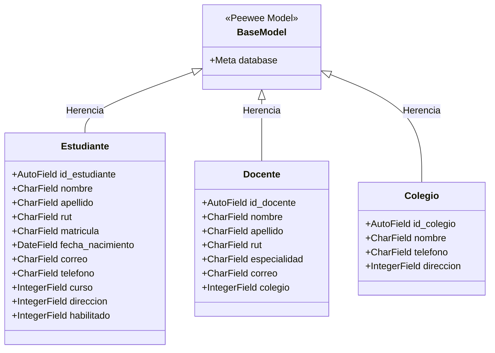
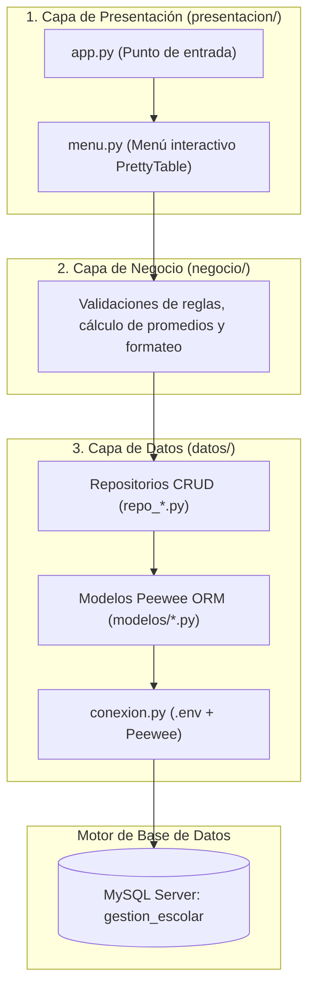
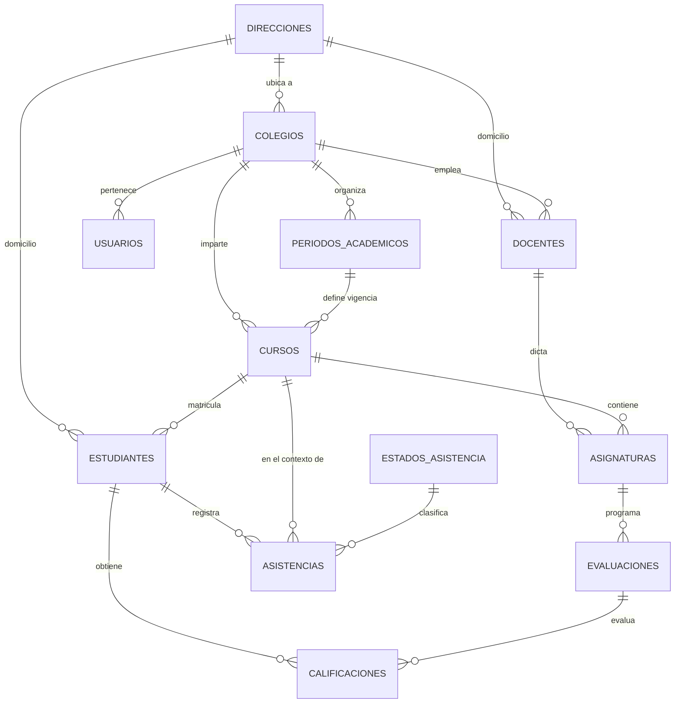

# INFORME TÉCNICO DE ARQUITECTURA Y DISEÑO
## Sistema de Gestión Escolar - Programación Orientada a Objetos (POO)

---

**Asignatura:** Programación Orientada a Objetos  
**Docente:** Erick Bailey  
**Proyecto:** Sistema de Gestión Escolar  
**Tecnologías:** Python 3.11+, Peewee ORM, PyMySQL, MySQL Server, Python-Decouple, PrettyTable  
**Fecha:** Octubre 2026  

---

## 1. Introducción y Objetivos del Proyecto

El presente proyecto consiste en el diseño e implementación de un **Sistema de Gestión Escolar**, desarrollado bajo los principios de la **Programación Orientada a Objetos (POO)** y una **arquitectura modular de software en capas**.

### Objetivos Principales:
1. **Modularización rigurosa:** Separar de manera estricta las responsabilidades de la aplicación en capas de **Presentación**, **Negocio** y **Datos**.
2. **Mapeo Objeto-Relacional (ORM):** Reemplazar la manipulación manual de cadenas SQL por objetos y clases de Python mediante **Peewee ORM**, garantizando tipado, integridad y mantenibilidad.
3. **Patrón Repositorio:** Centralizar el acceso y manipulación de datos en módulos especializados para desacoplar la base de datos de la lógica de interfaz.
4. **Seguridad y buenas prácticas:** Gestión de credenciales mediante variables de entorno (`.env`), soporte de borrado lógico (*soft-delete* vía bandera `habilitado`) y control de versiones colaborativo en Git/GitHub.

---

## 2. Fundamentos de POO y Principios de Diseño Aplicados

El proyecto refleja la aplicación directa de los conceptos fundamentales evaluados en la asignatura:



| Concepto POO | Justificación e Implementación en el Código |
|---|---|
| **Clase y Molde** | Cada entidad del dominio escolar cuenta con su propia clase (ej. `Estudiante`, `Docente`, `Curso`, `Evaluacion`). |
| **Objeto e Instancia** | Las consultas a la base de datos no retornan tuplas anónimas, sino instancias de objetos con propiedades y métodos asociados. |
| **Atributos de Datos** | Cada columna de la tabla relacional se modela como un atributo tipado (`CharField`, `IntegerField`, `DateField`, `FloatField`). |
| **Herencia** | Todas las clases de datos heredan de `BaseModel`, la cual comparte la conexión activa y la configuración de metadatos de la base de datos. |
| **Encapsulamiento** | La capa de presentación desconoce la estructura de las tablas SQL o los motores de bases de datos; únicamente interactúa mediante funciones de interfaz pública. |
| **Abstracción** | Un repositorio abstrae consultas complejas con funciones semánticas como `listado_estudiantes()` o `buscar_por_rut(rut)`. |
| **Modularidad** | Alta cohesión (cada módulo resuelve una única tarea) y bajo acoplamiento (los módulos dependen de contratos simples y no de implementaciones internas). |

---

## 3. Arquitectura del Software en Tres Capas

La aplicación está organizada siguiendo el patrón arquitectónico clásico de tres capas:



### Descripción de Componentes:
- **`app.py`:** Punto de arranque del programa. Inicializa el ciclo de vida de la aplicación e invoca al menú principal.
- **`auxiliares/`:** Módulo transversal que contiene variables globales (`nombre_app`, `version_app`) y constantes como `defecto = "DEFAULT 1"`.
- **`presentacion/`:** Interfaz de usuario por consola. Construye tablas legibles mediante `PrettyTable` y recopila entradas del usuario.
- **`negocio/`:** Alberga las reglas de negocio, validaciones y transformaciones lógicas antes de persistir o presentar.
- **`datos/conexion.py`:** Centraliza la conexión hacia MySQL usando `python-decouple` para no quemar contraseñas en el código fuente.
- **`datos/modelos/`:** Un archivo por cada tabla relacional con su mapeo ORM.
- **`datos/repositorios/`:** Funciones de persistencia agrupadas por entidad (`listado_`, `obtener_`, `registrar_`, `actualizar_`, `eliminar_`).
- **`datos/sql/`:** Scripts DDL y DML para recrear y poblar la base de datos desde cero en cualquier equipo.

---

## 4. Modelo de Datos y Entidades Escolares

El sistema abarca **11 tablas interconectadas**, diseñadas para satisfacer todas las necesidades operativas de una institución educativa:



### Diccionario de Módulos Implementados:

1. **`Direccion` (`direcciones`):** Almacena calle, número, comuna y ciudad. Base compartida por personas y colegios.
2. **`Colegio` (`colegios`):** Entidad educativa central con teléfono y dirección.
3. **`Usuario` (`usuarios`):** Acceso administrativo con nombre, correo único y contraseña.
4. **`PeriodoAcademico` (`periodos_academicos`):** Define el año y semestre escolar con fechas de inicio y fin.
5. **`Curso` (`cursos`):** Nivel (ej: "3° Medio") y letra ("A", "B"), vinculado a su colegio y periodo.
6. **`Docente` (`docentes`):** Profesores del establecimiento con RUT único, correo, especialidad y teléfono.
7. **`Asignatura` (`asignaturas`):** Materias lectivas (ej: "Matemáticas"), con carga horaria semanal y docente asignado.
8. **`Estudiante` (`estudiantes`):** Alumnos con matrícula única, RUT, fecha de nacimiento, contacto y curso.
9. **`Evaluacion` (`evaluaciones`):** Certámenes o exámenes con fecha y porcentaje de ponderación.
10. **`Calificacion` (`calificaciones`):** Notas numéricas (float) asignadas a un estudiante por cada evaluación con fecha y observación.
11. **`Asistencia` y `EstadoAsistencia` (`asistencias`, `estados_asistencia`):** Registro de asistencia diaria categorizado por estados del catálogo (Presente, Ausente, Justificado).

---

## 5. Implementación del Patrón Repositorio y CRUD

Cada entidad cuenta con un repositorio homólogo en `datos/repositorios/` que ofrece operaciones atómicas estandarizadas:

```python
# Ejemplo: repo_estudiante.py

def listado_estudiantes():
    estudiantes = Estudiante.select().where(Estudiante.habilitado == 1)
    return list(estudiantes)

def registrar_estudiante(nombre, apellido, rut, matricula, ...):
    nuevo = Estudiante.create(
        nombre=nombre,
        apellido=apellido,
        rut=rut,
        matricula=matricula,
        ...
        habilitado=1
    )
    return nuevo

def eliminar_estudiante(id_estudiante):
    # Borrado lógico (Soft-delete) para mantener trazabilidad histórica
    consulta = Estudiante.update(habilitado=0).where(Estudiante.id_estudiante == id_estudiante)
    consulta.execute()
```

### Características Técnicas del Repositorio:
- **Borrado Lógico (*Soft Delete*):** La eliminación no destruye el registro físico con `DELETE FROM`, sino que actualiza `habilitado = 0`, preservando la integridad referencial de calificaciones y asistencias pasadas.
- **Consultas Filtradas:** Los listados filtran por defecto los registros habilitados (`where(Entidad.habilitado == 1)`).
- **Mapeo Directo a Instancias:** Las funciones devuelven objetos Peewee que pueden ser consultados o pasados a la capa de presentación.

---

## 6. Configuración, Despliegue y Pruebas

### Requisitos Previos:
- Python 3.11 / 3.12 instalado.
- Servidor MySQL activo en `localhost:3306`.

### Pasos de Instalación:

1. **Instalación de paquetes:**
   ```powershell
   python -m pip install peewee PyMySQL python-decouple prettytable
   ```

2. **Carga de Base de Datos:**
   Ejecutar en MySQL Workbench el script:
   `datos/sql/2026.09.09_14.25_DDL_gestionescolar.sql`

3. **Configuración de Variables de Entorno (`.env`):**
   ```dotenv
   db=gestion_escolar
   host=localhost
   port=3306
   user=root
   password=tu_contraseña
   ```

4. **Ejecución:**
   ```powershell
   python app.py
   ```

---

## 7. Conclusión

El proyecto **Gestión Escolar** cumple a cabalidad con los estándares exigidos por la cátedra de Programación Orientada a Objetos:
- Implementación real y funcional del **ORM Peewee** sobre MySQL.
- **Separación de responsabilidades** limpia entre datos, lógica y presentación.
- Código legible, mantenible y sin dependencias superfluas.
- Repositorio en GitHub ordenado con historial de commits descriptivo y control de ramas limpio.

